<p align="center">
  
</p>

<p align="center"><a href="README.md">Português</a> · <b>English</b></p>

<p align="center">
  
  
  
  
  
</p>

<p align="center">
  
  
  
</p>

<p align="center"><sub>Built with Rust, RustCrypto, ratatui and Claude</sub></p>

<p align="center"></p>

> **Showcase repository.** Development happens in a private repository; this is a cut of it: the code and the tests, with no data or secrets. [MIT](LICENSE) license.

# neka

**neka** is a password manager for your terminal. It keeps everything in a **single encrypted file** (`.neka`), syncs between your computers through the Google Drive folder you already have, and talks to you in a colorful terminal with the **Cotton Candy** look (Algodão-Doce) of [Kotsu](https://github.com/Sera-DAI/kotsu). It starts on Windows; the Rust core was written to also power an Android app.

No account, no server, no telemetry: there is the file, your master password and a recovery key that is shown only once.

## Contents

- [I. What it does](#i-what-it-does)
- [II. Install](#ii-install)
- [III. Use](#iii-use)
- [IV. Security and limits](#iv-security-and-limits)
- [V. How it works inside](#v-how-it-works-inside)
- [VI. Development](#vi-development)
- [VII. Status and license](#vii-status-and-license)

## I. What it does

<table>
  <tr>
    <td width="72" align="center"></td>
    <td><b>One file</b><br>Entries, password history and tombstones in a <code>.neka</code> encrypted with <b>Argon2id</b> and <b>XChaCha20-Poly1305</b>. Whoever has the file but not the password only sees bytes.</td>
  </tr>
  <tr>
    <td align="center"></td>
    <td><b>Syncs through your Drive</b><br><code>neka sync-folder</code> points to a Google Drive folder. Merging is per entry, and a conflict never silently deletes anything.</td>
  </tr>
  <tr>
    <td align="center"></td>
    <td><b>Pretty and fast</b><br><code>neka list</code> prints a table, <code>neka copy</code> copies the password and clears the clipboard after 20 s, and <code>neka ui</code> opens an interactive screen.</td>
  </tr>
  <tr>
    <td align="center"></td>
    <td><b>In and out</b><br>Imports CSV (Bitwarden, Chrome, KeePassXC, 1Password) and KDBX; exports encrypted KDBX or plain-text CSV, only with <code>--plaintext</code>.</td>
  </tr>
  <tr>
    <td align="center"></td>
    <td><b>Recoverable</b><br>The 256-bit recovery key is shown once. Changing the master password makes a new one and revokes the old.</td>
  </tr>
</table>

## II. Install

<table>
  <tr>
    <td width="72" align="center"></td>
    <td>Requires <a href="https://rustup.rs">Rust</a> (the version is pinned in <code>rust-toolchain.toml</code>). There is no installer or published package yet: build from source.</td>
  </tr>
</table>

```powershell
git clone https://github.com/Sera-DAI/neka.git
cd neka
cargo install --path neka-cli     # coloca o neka em %USERPROFILE%\.cargo\bin
```

Reopen the terminal and run `neka --help`. On a second computer, once the Drive folder has synced: `neka clone "<Drive folder>\neka\cofre.neka"`.

## III. Use

<table>
  <tr>
    <td width="72" align="center"></td>
    <td>The interface is in English; the old Portuguese command names still work as hidden aliases.</td>
  </tr>
</table>

```text
neka create                      # creates the vault in %APPDATA%\neka and shows the recovery key
neka sync-folder "<Drive folder>\neka"
neka add Banco -u ana --url https://banco.exemplo -t financas
neka add Email --generate 24     # generates the password
neka list [busca] [-t etiqueta]  # alias: ls (password hidden; --reveal shows it)
neka copy Banco                  # copies the password, clears it after 20 s
neka show Banco [--password] [--history]
neka edit Banco --generate       # new password; the old one goes to history
neka remove Banco                # alias: rm (-y skips the prompt)
neka sync                        # also happens on its own with every command
neka import export-bitwarden.csv # or .kdbx
neka export backup.kdbx          # or .csv --plaintext
neka master-password             # changes it and makes a new recovery key
neka recover                     # opens with the recovery key
neka ui                          # interactive screen
```

**Look.** In a terminal the output follows the Cotton Candy theme (pink, blue and gold, with ♡ ☁ ✧); night is the default and `NEKA_THEME=light` switches to the light one. In a pipe, with a redirect or with `NO_COLOR`, it prints plain text, no colors or decoration. The master password never goes through an argument: only through a no-echo prompt.

In the interactive screen (`neka ui`): `Enter` reveals, `c` copies the password, `u` copies the username, `/` searches, `q` quits.

## IV. Security and limits

<table>
  <tr>
    <td width="72" align="center"></td>
    <td>What neka promises, and what it does not, is described in the project's security documentation, which is not part of this showcase for now. In short:</td>
  </tr>
</table>

- Only standard RustCrypto primitives; no home-made cryptography.
- Writes are atomic (temp file, `fsync`, rename) and each vault has a lock.
- Errors are typed codes with fixed text: passwords and vault contents never reach a log or a message.
- Whoever loses the master password **and** the recovery key loses the vault. That is on purpose.
- Limits the tests cannot reach (zeroing memory, the clipboard, a real power cut) are declared in that document.

> **Do not use it as your only vault yet.** The project is young (version 0.0.x), has had no external audit and the file format is a draft.

## V. How it works inside

<table>
  <tr>
    <td width="72" align="center"></td>
    <td>Layers with boundaries that a test enforces: if a layer imports what it must not, the build fails.</td>
  </tr>
</table>

| Layer | Where | What it does |
| --- | --- | --- |
| Domain | `neka-core::model` | Types and validation, no I/O |
| Crypto and storage | `neka-core::crypto`, `store` | KDF, cipher, atomic writes, migrations |
| Transfer | `neka-core::sync`, `io` | Version merging, import and export |
| Application | `neka-core::api` | High-level operations, typed errors |
| Interface | `neka-cli` | Arguments, prompts, clipboard, colors; no business rules |

The file format specification, the working rules and the numbered decisions are kept outside this showcase.

## VI. Development

<table>
  <tr>
    <td width="72" align="center"></td>
    <td>Tests use only temporary vaults with fictional passwords and never touch the network.</td>
  </tr>
</table>

```bash
cargo fmt --all --check
cargo clippy --workspace --all-targets -- -D warnings
cargo test --workspace
```

The merge property tests and the layer-dependency test run with `cargo test`.

## VII. Status and license

**Status.** The core, sync, import/export and the full CLI are done and tested on Windows. Next: a week of real use, the terminal design and then the Android app. TOTP comes later as an extra field, without changing the format.

<table>
  <tr>
    <td width="72" align="center"></td>
    <td><a href="LICENSE">MIT</a> license, like Kotsu. Made with care, little by little.</td>
  </tr>
</table>

<p align="center"></p>

<p align="center"><sub>Images generated by <code>scripts/gerar_imagens.py</code> · fonts and licenses in <code>docs/imagens/FONTES.md</code></sub></p>
