<p align="center">
  
</p>

<p align="center"><b>Português</b> · <a href="README.en.md">English</a></p>

<p align="center">
  
  
  
  
  
</p>

<p align="center">
  
  
  
</p>

<p align="center"><sub>Feito com Rust, RustCrypto, ratatui e Claude</sub></p>

<p align="center"></p>

> **Repositório de vitrine.** O desenvolvimento acontece num repositório privado; aqui fica um recorte: o código e os testes, sem dados nem segredos. Licença [MIT](LICENSE).

# neka

**neka** é um gerenciador de senhas para o terminal. Guarda tudo num **único arquivo cifrado** (`.neka`), sincroniza entre os seus computadores pela pasta do Google Drive que você já tem e fala com você num terminal colorido, no visual **Algodão-Doce** do [Kotsu](https://github.com/Sera-DAI/kotsu). Começa no Windows; o núcleo em Rust foi escrito para virar também um app Android.

Sem conta, sem servidor, sem telemetria: o que existe é o arquivo, a sua senha mestra e uma chave de recuperação que só aparece uma vez.

## Sumário

- [I. O que ele faz](#i-o-que-ele-faz)
- [II. Instalar](#ii-instalar)
- [III. Usar](#iii-usar)
- [IV. Segurança e limites](#iv-segurança-e-limites)
- [V. Como é por dentro](#v-como-é-por-dentro)
- [VI. Desenvolvimento](#vi-desenvolvimento)
- [VII. Estado e licença](#vii-estado-e-licença)

## I. O que ele faz

<table>
  <tr>
    <td width="72" align="center"></td>
    <td><b>Um arquivo só</b><br>Entradas, histórico de senhas e lápides num <code>.neka</code> cifrado com <b>Argon2id</b> e <b>XChaCha20-Poly1305</b>. Quem tem o arquivo e não tem a senha só vê bytes.</td>
  </tr>
  <tr>
    <td align="center"></td>
    <td><b>Sincroniza pelo seu Drive</b><br><code>neka sync-folder</code> aponta para uma pasta do Google Drive. A mesclagem é por entrada, e conflito nunca apaga nada em silêncio.</td>
  </tr>
  <tr>
    <td align="center"></td>
    <td><b>Bonito e rápido</b><br><code>neka list</code> mostra uma tabela, <code>neka copy</code> copia a senha e limpa a área de transferência em 20 s, e <code>neka ui</code> abre uma tela interativa.</td>
  </tr>
  <tr>
    <td align="center"></td>
    <td><b>Entra e sai</b><br>Importa CSV (Bitwarden, Chrome, KeePassXC, 1Password) e KDBX; exporta KDBX cifrado ou CSV em texto puro, só com <code>--plaintext</code>.</td>
  </tr>
  <tr>
    <td align="center"></td>
    <td><b>Recuperável</b><br>A chave de recuperação de 256 bits é mostrada uma vez. Trocar a senha mestra gera outra e revoga a antiga.</td>
  </tr>
</table>

## II. Instalar

<table>
  <tr>
    <td width="72" align="center"></td>
    <td>Requer o <a href="https://rustup.rs">Rust</a> (a versão fica fixada em <code>rust-toolchain.toml</code>). O programa ainda não tem instalador nem pacote publicado: compile do código.</td>
  </tr>
</table>

```powershell
git clone https://github.com/Sera-DAI/neka.git
cd neka
cargo install --path neka-cli     # coloca o neka em %USERPROFILE%\.cargo\bin
```

Reabra o terminal e rode `neka --help`. Num segundo computador, com a pasta do Drive já sincronizada: `neka clone "<pasta do Drive>\neka\cofre.neka"`.

## III. Usar

<table>
  <tr>
    <td width="72" align="center"></td>
    <td>A interface fala inglês; os nomes antigos em português continuam funcionando como apelidos escondidos.</td>
  </tr>
</table>

```text
neka create                      # cria o cofre em %APPDATA%\neka e mostra a chave de recuperação
neka sync-folder "<pasta do Drive>\neka"
neka add Banco -u ana --url https://banco.exemplo -t financas
neka add Email --generate 24     # gera a senha
neka list [busca] [-t etiqueta]  # alias: ls (senha oculta; --reveal mostra)
neka copy Banco                  # copia a senha e limpa em 20 s
neka show Banco [--password] [--history]
neka edit Banco --generate       # nova senha; a antiga vai para o histórico
neka remove Banco                # alias: rm (-y não pergunta)
neka sync                        # também acontece sozinho a cada comando
neka import export-bitwarden.csv # ou .kdbx
neka export backup.kdbx          # ou .csv --plaintext
neka master-password             # troca a senha e gera nova chave de recuperação
neka recover                     # abre com a chave de recuperação
neka ui                          # tela interativa
```

**Visual.** No terminal a saída segue o tema Algodão-Doce (rosa, azul e dourado, com ♡ ☁ ✧); a noite é o padrão e `NEKA_THEME=light` troca para o claro. Em pipe, redirecionamento ou com `NO_COLOR`, sai texto puro, sem cor nem enfeite. A senha mestra nunca vai por argumento: só por prompt sem eco.

Na tela interativa (`neka ui`): `Enter` revela, `c` copia a senha, `u` copia o usuário, `/` busca, `q` sai.

## IV. Segurança e limites

<table>
  <tr>
    <td width="72" align="center"></td>
    <td>O que o neka promete e o que ele não promete estão descritos na documentação de segurança do projeto, que por ora não faz parte desta vitrine. O resumo:</td>
  </tr>
</table>

- Só primitivas padrão da família RustCrypto; nada de criptografia inventada.
- A gravação é atômica (temporário, `fsync`, renomeação) e há uma trava por cofre.
- Erros são códigos tipados com texto fixo: senha e conteúdo do cofre nunca entram em log nem em mensagem.
- Quem perde a senha mestra **e** a chave de recuperação perde o cofre. É de propósito.
- Limitações que os testes não alcançam (zerar memória, área de transferência, queda de energia real) estão declaradas no documento.

> **Ainda não use como único cofre.** O projeto é jovem (versão 0.0.x), não passou por auditoria externa e o formato do arquivo está em rascunho.

## V. Como é por dentro

<table>
  <tr>
    <td width="72" align="center"></td>
    <td>Camadas com fronteiras que um teste verifica: se uma camada importar o que não pode, o build falha.</td>
  </tr>
</table>

| Camada | Onde | O que faz |
| --- | --- | --- |
| Domínio | `neka-core::model` | Tipos e validações, sem I/O |
| Cripto e armazenamento | `neka-core::crypto`, `store` | KDF, cifra, gravação atômica, migrações |
| Transferência | `neka-core::sync`, `io` | Mesclagem de versões, importação e exportação |
| Aplicação | `neka-core::api` | Operações de alto nível, erros tipados |
| Interface | `neka-cli` | Argumentos, prompts, área de transferência, cores; nenhuma regra de negócio |

A especificação do formato do arquivo, as regras de trabalho e as decisões numeradas ficam fora desta vitrine.

## VI. Desenvolvimento

<table>
  <tr>
    <td width="72" align="center"></td>
    <td>Os testes usam só cofres temporários com senhas fictícias e nunca acessam a rede.</td>
  </tr>
</table>

```bash
cargo fmt --all --check
cargo clippy --workspace --all-targets -- -D warnings
cargo test --workspace
```

Os testes de propriedade da mesclagem e o teste de dependência entre camadas rodam junto com `cargo test`.

## VII. Estado e licença

**Estado.** Núcleo, sincronização, importação/exportação e a CLI completa estão prontos e testados no Windows. Próximos passos: uma semana de uso real, o design do terminal e, depois, o app Android. TOTP entra mais tarde como campo extra, sem mudar o formato.

<table>
  <tr>
    <td width="72" align="center"></td>
    <td>Licença <a href="LICENSE">MIT</a>, como o Kotsu. Feito com carinho, aos pouquinhos.</td>
  </tr>
</table>

<p align="center"></p>

<p align="center"><sub>Imagens geradas por <code>scripts/gerar_imagens.py</code> · fontes e licenças em <code>docs/imagens/FONTES.md</code></sub></p>
